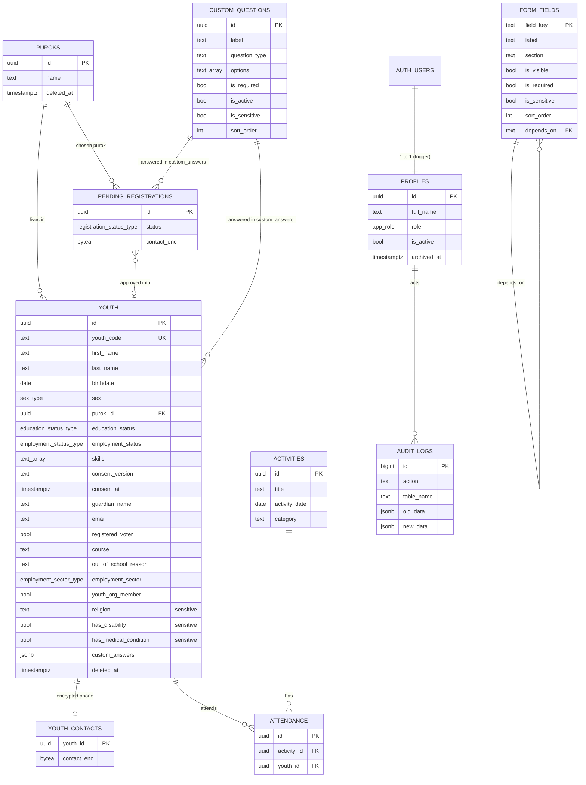

# Database design

Run order: `supabase/01_schema.sql`, `02_security.sql`, `03_seed.sql`, `04_form_fields_extra.sql`, `05_form_settings.sql`, `06_custom_questions.sql`, `07_user_management.sql`, `08_viewer_aggregate_only.sql`. Re-running a file means running every later file again, in order.

## ERD

## Enums

`app_role` (admin, encoder, viewer), `sex_type`, `civil_status_type` (single, married, widowed, separated, live_in, others), `education_status_type` (in_school, out_of_school, graduated), `education_level_type` (elementary, junior_high, senior_high, alternative_learning, vocational, college, postgraduate, doctorate), `employment_status_type` (employed, self_employed, unemployed), `employment_sector_type` (government, private, self_employed), `registration_status_type`.

## Fields from the paper Youth Profile Form (04)

Added to both `youth` and `pending_registrations`: `email` (120, format checked), `registered_voter`, `civil_status_other` (60), `course` (120), `out_of_school_reason` (200), `employment_sector`, `employment_duration` (60), `government_agency` (120), `youth_org_member`, `youth_org_name` (120), and the sensitive `religion` (60), `has_disability`, `disability_details` (200), `has_medical_condition`, `medical_details` (200). `civil_status` and `employment_status` are now nullable (null = not answered).

## Form settings (05)

`form_fields` holds one row per optional field: `is_visible`, `is_required`, `is_sensitive`, `section` (personal, other), `sort_order`, `depends_on`. Core fields are not in it. `apply_form_settings()` runs before insert/update on `youth` and before insert on `pending_registrations`: hidden fields get no value on a new record and keep their saved value on an edit; a required field that applies must be answered on insert and cannot be blanked on an edit. `approve_registration()` skips it, because the registration was checked when submitted.

## Key rules in the database

| Rule | How |
|---|---|
| Unique ID per youth | `youth_code` from a sequence (`KK-2026-00001`) plus UUID primary key |
| Duplicate detection | Unique index on lower(first), lower(last), middle, birthdate among non-deleted rows |
| Age 15 to 30 | `validate_youth_row` trigger (computed from birthdate) |
| Guardian consent for minors | Same trigger: age at consent date below 18 requires guardian name and consent time |
| Age and bracket | Not stored (they change). The `youth_overview` view computes them |
| OSY flag and referrals | `is_osy` and `suggest_referrals()` in the view |
| Skills normalized | Lowercased, trimmed, de-duplicated by trigger |
| Aggregates | `dashboard_summary()`, `activity_stats` view, `summary_report()` (SQL, not client counting; usable by Viewers, counts only, "<3" for 1 or 2) and `unreached_youth()` (names, Admin and Encoder only) |
| Soft delete | `deleted_at`; RLS hides deleted rows from non-admins; no DELETE policy on youth |
| Conditional fields | `clean_profile_extras` trigger: course only for college/vocational/post-graduate/doctorate, OSY reason only when out of school, sector and agency only when employed, "others" text only for civil status others, org name required when member, details only when yes |
| Sensitive needs SPI consent | Same trigger: religion/disability/medical values need a consent version ending in `-SPI` |
| Form settings | `apply_form_settings` trigger, `form_fields_guard` (hidden is never required; a field cannot be hidden while a dependent field is shown) |

## Indexes

`youth_no_duplicates` (unique), `youth_purok_idx`, `youth_birthdate_idx`, `youth_education_idx`, `youth_employment_idx` (partial on `deleted_at is null`), `youth_name_idx`, `attendance_youth_idx`, `activities_date_idx`, `pending_status_idx`, `audit_created_idx`, `audit_table_idx`.

## Custom questions (06)

`custom_questions` (label, help_text, question_type: text / single_choice / multi_choice / yes_no, options, is_required, is_active, is_sensitive, sort_order). No hard delete (a trigger blocks it, even for the owner); type and sensitive flag cannot change after creation. Answers live in `custom_answers jsonb` on `youth` and `pending_registrations`, keyed by question id. `validate_custom_answers()` checks type, options, required, the 300-character text limit and unknown keys; answers to deactivated questions are kept on edit and dropped from new records. `approve_registration()` and `import_youth()` carry the answers.

## Views

`youth_overview` and `activity_stats` use `security_invoker = true`, so the caller's Row Level Security applies to them. Without this, a view would bypass RLS. `youth_overview` has the new non-sensitive fields but no sensitive ones.

`youth_custom_answers` (id, answers, sensitive_answers) also runs with the owner's rights, because `custom_answers` is not readable through `youth`. `answers` holds the non-sensitive answers for every signed-in role; `sensitive_answers` is filled only for Admin and Encoder.

`youth_sensitive` (religion, disability, medical) is the other view that runs with the owner's rights, because API roles have no SELECT on those columns. It returns rows only to Admin and Encoder and repeats the soft-delete rule of the `youth read` policy.
