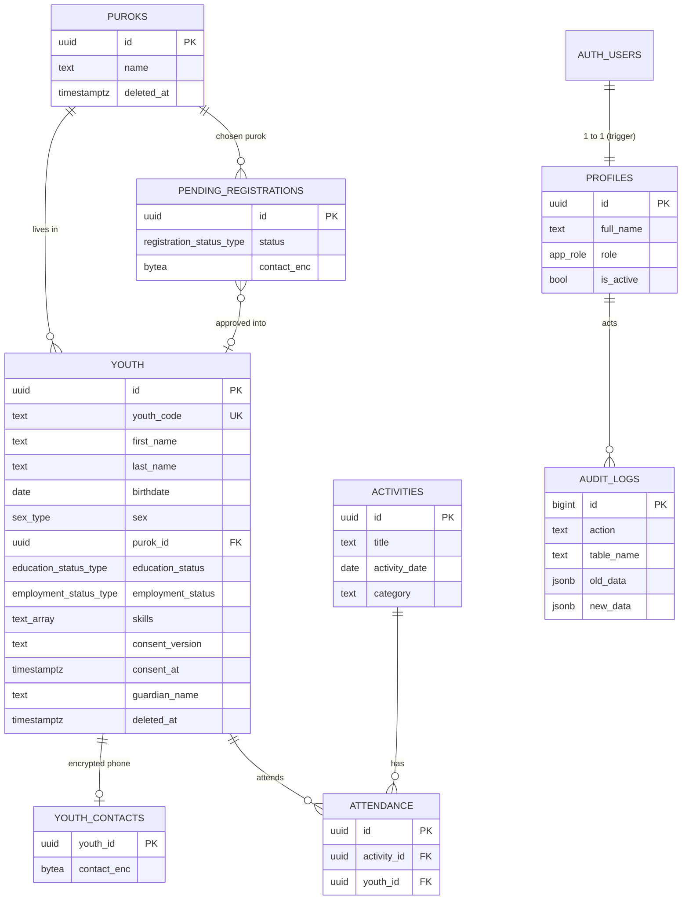

# Database design

Run order: `supabase/01_schema.sql`, `02_security.sql`, `03_seed.sql`.

## ERD

## Enums

`app_role` (admin, encoder, viewer), `sex_type`, `civil_status_type`, `education_status_type` (in_school, out_of_school, graduated), `education_level_type`, `employment_status_type` (employed, self_employed, unemployed), `registration_status_type`.

## Key rules in the database

| Rule | How |
|---|---|
| Unique ID per youth | `youth_code` from a sequence (`KK-2026-00001`) plus UUID primary key |
| Duplicate detection | Unique index on lower(first), lower(last), middle, birthdate among non-deleted rows |
| Age 15 to 30 | `validate_youth_row` trigger (computed from birthdate) |
| Guardian consent for minors | Same trigger: age at consent date below 18 requires guardian name and consent time |
| Age and bracket | Not stored (they change). The `youth_overview` view computes them |
| OSY flag and referrals | `is_osy` and `suggest_referrals()` in the view |
| Skills normalized | Lowercased, trimmed, de-duplicated by trigger |
| Aggregates | `dashboard_summary()`, `activity_stats` view, `unreached_youth()` (SQL, not client counting) |
| Soft delete | `deleted_at`; RLS hides deleted rows from non-admins; no DELETE policy on youth |

## Indexes

`youth_no_duplicates` (unique), `youth_purok_idx`, `youth_birthdate_idx`, `youth_education_idx`, `youth_employment_idx` (partial on `deleted_at is null`), `youth_name_idx`, `attendance_youth_idx`, `activities_date_idx`, `pending_status_idx`, `audit_created_idx`, `audit_table_idx`.

## Views

`youth_overview` and `activity_stats` use `security_invoker = true`, so the caller's Row Level Security applies to them. Without this, a view would bypass RLS.
