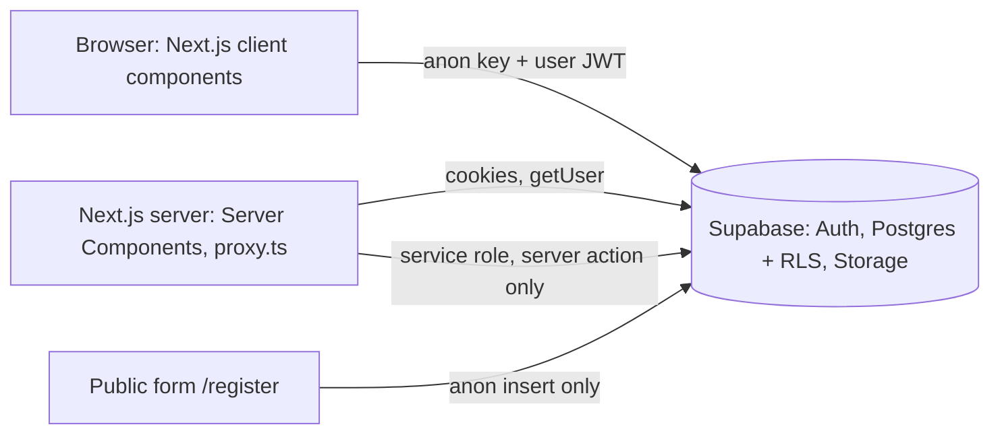

# Architecture and flows



- `proxy.ts` refreshes the session and redirects signed-in-only paths to `/login`.
- Server Components read data with the user's session (RLS applies). Client components write with the browser client (RLS applies). Pages also call `requireRole()` for friendly redirects; the database is the real gate.
- The service-role client exists in exactly one place (`lib/supabase/admin.ts`).

## User flows

**Youth (public):** Home, Register, fill form, consent (and guardian consent if under 18), submit. Waits in `pending_registrations`.

**Encoder:** Sign in, Registrations (approve or reject), add or edit profiles, upload consent scan, record attendance, import Excel, reports.

**Admin:** Everything above plus puroks, users and roles, audit log, purge, restore deleted profiles.

**Viewer:** Dashboard, registry (without contact numbers), OSY list, activities, reports.

## Auth flow

1. Admin creates the account (server action, service role) or in Supabase Dashboard. A trigger creates the `profiles` row as `viewer`; the action sets the role.
2. Login: `signInWithPassword` in the browser, cookies set by `@supabase/ssr`.
3. Each request: `proxy.ts` calls `getUser()` (validated with Auth), pages load the profile and role.
4. Deactivated users fail `get_user_role()`, so RLS denies everything immediately.

## Folder structure

```
app/                 routes (App Router)
  (app)/             signed-in area with the sidebar shell
    dashboard/ youth/ osy/ activities/ reports/ registrations/ import/ puroks/ admin/
  login/ register/ privacy/ auth/signout/
components/          shared UI (ui.tsx, AppShell, ProfileFields, YouthForm, ExportButtons, ...)
lib/                 constants, types, validation, format, export, errors
lib/supabase/        client.ts, server.ts, admin.ts (server-only)
proxy.ts             session refresh and route protection
supabase/            01_schema.sql, 02_security.sql, 03_seed.sql, tests/
docs/                this documentation
```
